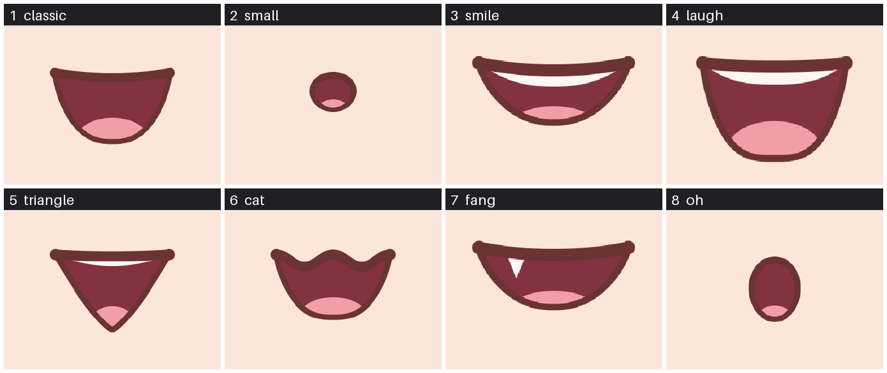
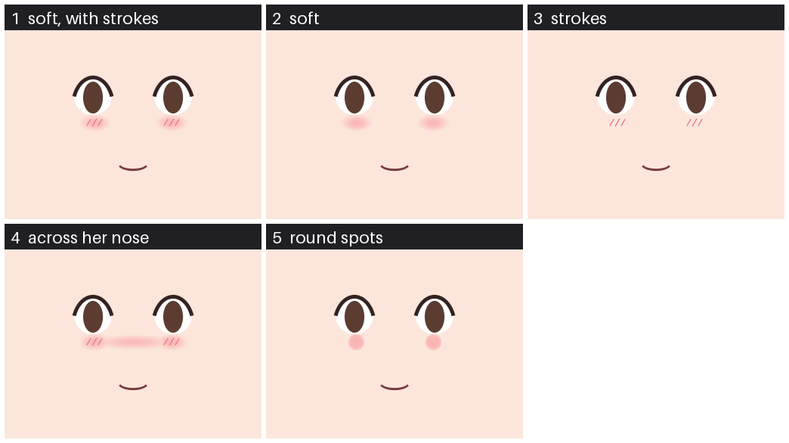

# Live2D kit: one drawing to a rigged Live2D model

This folder turns one full-body drawing of a character into a Live2D model you can load in AIRI,
Open-LLM-VTuber or any other Cubism player. The model blinks, talks, looks around, turns and tilts
her head, sways, breathes, lifts and bends her arms and bends her knees. It also has a set of
expressions, emotion motions and two reactions to a click.

You don't need Cubism Editor and you don't rig anything by hand. You run one step at a time, look
at a picture after each step, and fix what is off before you go on. A new character takes about an
afternoon. Most of that time is the PC working, not you.

The folder is self-contained: get it once, and make your characters inside it or in any other
project ([Another project](#another-project)). `SKILL.md` holds the same instructions for an agent.

## Contents
- [What you need](#what-you-need)
- [Set up once](#set-up-once)
- [The GUI](#the-gui)
- [A drawing that rigs](#a-drawing-that-rigs)
- [The steps](#the-steps)
- [Looks and styles](#looks-and-styles)
- [Mouths and blushes](#mouths-and-blushes)
- [Her eyes, drawn again](#her-eyes-drawn-again)
- [Her irises, from the kit](#her-irises-from-the-kit)
- [Fixing the layers](#fixing-the-layers)
- [Trying her model](#trying-her-model)
- [What her model can do](#what-her-model-can-do)
- [Changing how she moves](#changing-how-she-moves)
- [Her own expressions](#her-own-expressions)
- [Another project](#another-project)
- [What is in this folder](#what-is-in-this-folder)
- [Borrowed work and licences](#borrowed-work-and-licences)

## What you need

A Windows PC with an NVIDIA card with 12 GB of memory or more. The steps were made and tested on a
12 GB RTX 3080 Ti. About 45 GB of disk for everything below. Three things are installed apart
from the kit: ComfyUI, See-through and ffmpeg. The rest is in this folder.

| What | For which step | Where from | Size | Where it goes |
|---|---|---|---|---|
| Python 3.10 or newer | running `live2d.py` | python.org | small | anywhere |
| ComfyUI 0.43.0 or newer (the Windows portable build has its own Python). No custom nodes: the kit uses ComfyUI's own | draw, cutout, upscale | github.com/Comfy-Org/ComfyUI | about 10 GB | anywhere; settings `comfyui.python` and `comfyui.main` |
| `birefnet.safetensors` | cutout | huggingface.co/Comfy-Org/BiRefNet, folder `background_removal` | 0.4 GB | `<models>/background_removal/` |
| `RealESRGAN_x4plus_anime_6B.pth` | upscale | github.com/xinntao/Real-ESRGAN, release v0.2.2.4 | 18 MB | `<models>/upscale_models/` |
| `qwen_image_2.1_turbo_int8_convrot.safetensors` | draw on this PC | huggingface.co/Comfy-Org/Qwen-Image-2.1, folder `diffusion_models` | 7.3 GB | `<models>/diffusion_models/` |
| `qwen3vl_8b_int8_convrot.safetensors` | draw on this PC | same place, folder `text_encoders` | 9.4 GB | `<models>/text_encoders/` |
| `qwen_image_2.1_vae_bf16.safetensors` | draw on this PC | same place, folder `vae` | 0.7 GB | `<models>/vae/` |
| See-through, commit `df019de` | split, layers, parts | github.com/shitagaki-lab/see-through | about 8 GB with its Python packages | anywhere; settings `seethrough.repo` and `seethrough.python` |
| See-through's two models | split | Hugging Face, fetched by See-through on its first run | 12.6 GB | settings `seethrough.hf_home` |
| ffmpeg | the contact sheet of a round of drawings | ffmpeg.org | small | on the PATH, or settings `ffmpeg` |

`<models>` is one folder of your choice, the settings' `comfyui.models`. The kit hands it to
ComfyUI when it starts ComfyUI, so ComfyUI's own folder isn't changed.

You can skip the three Qwen files if you bring your own drawing or draw somewhere else. A style
LoRA or a tuned model of your own is optional too ([Looks and styles](#looks-and-styles)): LoRAs
go in `<models>/loras/`.

Installing See-through. It gets a Python environment of its own (Python 3.12), which the kit's
layer and build steps use too. The paths are examples, and `py -3.12` is Python 3.12 from
python.org.

```
git clone https://github.com/shitagaki-lab/see-through C:/AI/see-through/repo
git -C C:/AI/see-through/repo checkout df019de
py -3.12 -m venv C:/AI/see-through/venv
C:/AI/see-through/venv/Scripts/pip install torch==2.8.0+cu128 torchvision==0.23.0+cu128 torchaudio==2.8.0+cu128 --index-url https://download.pytorch.org/whl/cu128
C:/AI/see-through/venv/Scripts/pip install -r C:/AI/see-through/repo/requirements.txt -r C:/AI/see-through/repo/requirements-inference-bnb.txt
C:/AI/see-through/venv/Scripts/pip install psd-tools scipy pydantic
```

The second requirements file lets it run on a 12 GB card. The last line is what the kit's own
steps use (layers, parts, build); it does nothing for the ones already there. `df019de` is the
See-through commit the kit was written against.

The rigging code is part of the kit: `vendor/image2live2d/` holds the files of
[image2live2d](https://github.com/Wzhang3912/image2live2d) that the build uses, so there is no
second tool to install for it and nothing to keep in step.

## Set up once

1. In this folder, run:

   ```
   python live2d.py init
   ```

   This folder is then your project: your characters go in `characters/` and what the kit makes
   in `out/`, both beside the kit's own files and both left out of version control. To keep
   characters in another project's folder instead, see [Another project](#another-project).

   It makes three files, each only if it isn't there yet:
   - `live2d-kit.json`, the settings (a copy of `settings.example.json`). Put your own paths in it.
     `characters` is the folder that will hold one folder per character. `out` is a folder for
     everything the kit makes that you don't keep.
   - `<characters>/looks.json`, where you write what each character looks like
     ([Looks and styles](#looks-and-styles)). It starts with one example character.
   - `.claude/skills/live2d-from-drawing/SKILL.md`, a pointer, so an agent working in the project
     finds the kit's skill.

   If the tools are already installed for another project, `init --like <that project's folder>`
   copies their paths from its settings.
2. Run the check from anywhere inside the project:

   ```
   python live2d.py check
   ```

   It lists each program and model as `ok` or `MISSING`, and says which step needs it.

Every command in this file is run the same way: `python live2d.py <step> ...`, from the project's
folder. In another project it is the same command with the kit's path, such as
`python C:/tools/live2d/live2d.py <step> ...`. `live2d.py` picks the right Python for each step
and prints the command it runs, so you can see what happened and run a script by hand if you
want to.

## The GUI

If you would rather click through the steps than type them, run this from the project's folder:

```
python live2d.py gui
```

It prints an address, `http://127.0.0.1:8780/`: open it in a browser (`gui 8795` uses another port).
The page lists your characters and the nine steps below, each with what it does, the exact command
it will run, a Run button and the picture to look at afterwards. A log at the bottom shows the
command's output as it runs, with a Stop button. The GPU steps ask for a second click.

A badge at the top says whether ComfyUI is running, and the steps that need it offer only what
makes sense: Start when it isn't running, Stop when this project started it, and neither when it
was started from another folder (it can still be used; stop it where it was started). The page
looks again every 15 seconds, and a click on the badge looks at once. The split steps warn when
ComfyUI still holds part of the graphics card.

Every large picture (the layer check, her drawing, her cut-out, the contact sheets) has a
magnifier: hover over it to see that spot bigger, and turn the mouse wheel to zoom from 2 to 12
times. "Open it full size" under it opens the picture at its own size.

The page runs the same `python live2d.py <step> ...` commands you would type, one at a time, and
nothing else; it adds no steps of its own. It listens on this PC only. An agent should use the
commands, not the page.

## A drawing that rigs

The split and the rig expect a drawing like this:

- One character, whole body from head to shoes, standing, seen from the front.
- A transparent background, which `draw` asks for. If you bring your own picture: a plain light
  grey background. White works less well: light hair fades into it.
- Arms a little away from her sides, hands open and empty. An arm that lies on her body can't be
  cut away from it.
- Legs apart enough to see a gap between them. Then each leg gets its own knee.
- Mouth closed, eyes open, head upright. The kit straightens a tilted head, but an upright one
  gives a cleaner result.
- Nothing held, no bag across her body, no hair over her eyes if you can avoid it.
- About 928x1664. Bigger doesn't help the split, which works at 1280.

`live2d.py draw` writes its prompts this way. If you bring your own picture, check it against this
list first. A drawing that breaks these rules can still work, but expect more fixing.

## The steps

`<name>` is the character's folder name, such as `akane`. To see where a character is and what
comes next at any time:

```
python live2d.py status <name>
```

Close other programs that use the graphics card before the steps marked GPU. The times below are
for a free 12 GB card. Another program holding part of the card makes a split pass much slower:
one took 3.5 hours.

**1. Draw candidates** (GPU: half a minute to load the model, then a few seconds a picture with
the turbo model, or about a minute with a 20-step tuned one). Skip this if you have a drawing.

```
python live2d.py comfy start
python live2d.py draw akane-round1 --character akane --seeds 1,2,3,4
```

`--character akane` takes her description from the looks file. You can write it on the command
line instead: `--look "A young woman with long red hair in two pigtails, blue eyes, a white lab
coat over a black t-shirt, a lilac tartan skirt, grey thigh-high stockings and black boots."`
Add `--show` to either one to see the whole prompt without drawing anything.

Pictures and a contact sheet go to `<out>/akane-round1/`. Run more seeds or change the words until
one is right. `prompts.txt` in the round's folder records the prompt and seed of every picture. In
the GUI, the Random seeds button fills the box with new seeds, as many as it held before.

The pictures have a transparent background. Qwen Image 2.1 draws a real alpha channel when the
prompt asks for one, so her edges were never mixed with a background and nothing has to be cut
away. The contact sheet shows them on grey. `--background` draws on plain light grey instead.

**2. Pick one.**

```
python live2d.py pick akane <out>/akane-round1/akane-round1-3.png
```

It becomes `<characters>/akane/full/base.png`. Beside it, `base.json` keeps the prompt, seed and
model it was drawn with, so you can draw her again or draw a change to her later.

A picture with a transparent background is also her cut-out: `pick` writes `full/cutout.png`
from it (the faint haze left over the background cleared), and her drawing on light grey as
`base.png`. Go straight to `upscale` in step 3.

**3. Cut her out and upscale her** (GPU, about two minutes together). A drawing picked with its own
transparency is already cut out: `cutout` says so and does nothing, so run only `upscale`.

```
python live2d.py cutout akane
python live2d.py upscale akane
python live2d.py comfy stop
```

Look at `full/cutout.png`: she should be whole, with no background left. Stop ComfyUI before the
next step. The next step needs the whole card.

It is easy to leave ComfyUI running. `python live2d.py comfy status` says whether it is, whether
this project started it, and how much of the card it holds; `check` says the same in one line,
and `split` warns before it starts if ComfyUI still holds a gigabyte or more. `comfy start` won't
start a second one, and `comfy stop` stops only the one this project started.

`cutout` is for a picture that has a background: your own, or one drawn with `--background`. It
uses BiRefNet and takes the background's colour back out of her edges. It does that well, but a
drawn transparency is cleaner: on the same drawing, BiRefNet's cut left about 1,000 near-white
pixels on her edges, the drawn one 11. `cutout <name> --again` cuts a transparent drawing out
with BiRefNet anyway.

**4. Split her into layers** (GPU, about 10 minutes).

```
python live2d.py split akane body
```

See-through cuts her into about 17 layers (hair, face, eyes, clothes) and paints in what is hidden
behind each one. Her layers land in `<characters>/akane/layers/full/parts/`, one picture each.

**5. Check and fix her layers.** This is the step that needs your eyes.

```
python live2d.py layers check akane
```

It counts the pixels where her layers, stacked, differ from her drawing, and saves a picture with
the differences in red (`<out>/layers/akane-full-check.png`). A few thousand pixels of thin red
outline is normal. A red block means a layer is in the wrong place or covers something it
shouldn't. [Fixing the layers](#fixing-the-layers) has the usual cases.

**6. Head pass** (GPU, about 12 minutes). Her face is small in the whole-body split, so her
head is split again from a four-times-bigger drawing.

```
python live2d.py split akane head
python live2d.py layers scale akane 2
python live2d.py layers head akane <the head PSD it names> <characters>/akane/layers/full/head-crop.json
python live2d.py layers under akane neck face
```

`split head` prints the last two lines with the right paths in them. The last line cleans her neck
under her chin, so no second jaw line shows when her head lifts. If one still shows beside her
neck, run it for her back hair too: `layers under akane "back hair" face`.

`layers head` also keeps each head layer at the head pass's own size, about twice her frame's
(`parts/<layer>@head.png`). `build` puts those in her model's texture, so her face, eyes and brows
stay sharp when an app shows her close up. A character whose head layers were taken with an older
kit gets them with `python live2d.py layers sharp akane`, then `build`. Her layers stay the truth:
if you change a head layer afterwards, `build` sees that its sharp copy no longer matches and
uses the layer as it is.

**7. Closed eyes and open mouth.** The drawing has her eyes open and her mouth shut. These draw
the other two.

```
python live2d.py parts closed-eyes akane
python live2d.py parts mouth akane
```

`parts mouth` draws the kit's plain open mouth. [Mouths and blushes](#mouths-and-blushes) has the
other mouths you can pick, how to use a mouth picture of your own, and the same for her blush.

Her closed eyes also make her smile: with her eyes shut, `ParamEyeLSmile` and `ParamEyeRSmile`
bend each closed eye's line into an anime "^". With her eyes open they only narrow them, from
below. The `happy` expression, the `Smile` motion and the head pat shut her eyes for it, so moving
the smile slider alone in the viewer shows the narrowing, not the "^": move her eyes' open sliders
to 0 as well.

Some drawings have a closed mouth so thin or faint that it can't be seen from afar, and a smile or
frown (`ParamMouthForm`) hardly shows on it. `parts mouth-line` draws it again as a firmer line
along its own curve. Try it first: `--try` makes a picture of her drawn mouth beside the new one
(`<out>/parts/akane-full-mouth-line.png`) and changes nothing.

```
python live2d.py parts mouth-line akane --try
python live2d.py parts mouth-line akane --size 1.2 --thick 1.3
python live2d.py parts mouth akane
```

`--size` makes it longer or shorter, `--thick` thicker or thinner than the kit's choice, and
`--dark` (0 to 1, 0.35 when not given) how far its colour goes from hers toward a dark warm
brown. The patch of skin her mouth layer may have stays, with her old line painted out. Her drawn
mouth is kept, so each redraw starts from it, and `--back` puts it back. Draw her open mouth again
afterwards (the last line above), so it fits the new line; it keeps her style and settings. In the
GUI, step 7 has sliders for these, with Try it, Redraw and Put back buttons.

**8. Build her model** (no GPU, about a minute).

```
python live2d.py build akane
```

Her model is `<out>/live2d/akane-full/model/`. The same files zipped, for an app's import, are
`<out>/live2d/akane-full.zip`. Read what it prints: how far it turned her head upright, how many
arms and legs it found, and any part it could not place.

**9. Try her.**

```
python live2d.py view
```

Open `http://127.0.0.1:8777/live2d/`. [Trying her model](#trying-her-model) says what to look for.
When something looks wrong, `references/problems.md` lists what we have seen and how each was
fixed. Fix, build again, reload the page.

Keep these in version control: `full/base.png`, `full/cutout.png`, `full/base-2x.png`, and all of
`layers/full/`. Everything in `<out>` can be made again.

## Looks and styles

`<characters>/looks.json` is the one place that says what each character looks like. The kit's
`templates/looks.example.json` is the pattern, and `init` puts a copy there.

```json
{
  "characters": {
    "mika": {
      "looks": {
        "default": "A young woman with long straight teal hair with blunt bangs, amber eyes ...",
        "summer": "A young woman with long straight teal hair tied in a high ponytail ..."
      },
      "negative": ""
    }
  },
  "styles": {
    "soft": {"words": "Soft pastel anime illustration, thin clean line art, gentle flat shading."},
    "mine": {"words": "mystyle, flat colour.", "lora": "my-style.safetensors", "strength": 0.8}
  }
}
```

- **A look** is plain words: hair, eyes, build and clothes, from head to shoes. Leave out the pose
  and the background. The kit adds those, because the pose is what makes a drawing rig well.
  `--character mika` draws her `default` look and `--character mika:summer` the one called `summer`.
- **A style** is optional. `--style soft` puts its `words` first in the prompt, in place of the
  kit's own art style words ("Clean cel-shaded anime illustration, crisp line art, soft even
  lighting."). The framing sentence and the pose stay.
- **A LoRA** is a file in `<models>/loras/`. Name it in a style (`lora`, `strength`) or once on the
  command line: `--lora my-style.safetensors:0.8`. Put its trigger words in the style's `words`.
- **A tuned model** of your own goes in `<models>/diffusion_models/`. Name it in a style (`unet`),
  with the `steps` and `cfg` it needs.

A project that needs more than this (several prompt styles, a paid account, a record of every
round) can keep a script of its own on top of `scripts/draw.py`. Its `workflow()` builds the
ComfyUI graph and `run()` draws a list of jobs and makes the contact sheet.

## Mouths and blushes

Her open mouth and her blush are drawn for her, and you choose which. The first time, look at
them on her own face:

```
python live2d.py parts mouth-sheet akane
python live2d.py parts blush-sheet akane
```

Each saves a numbered picture: `<out>/parts/akane-full-mouths.png` and `akane-full-blushes.png`.
In the GUI (step 7) the mouths and blushes are pictures to click, on plain skin until you press
"Show them on her face"; the one she has now is marked.

**Her open mouth.** Three ways:

| You want | Run |
|---|---|
| The plain one (what step 7 draws) | `parts mouth akane` |
| One of the kit's, by its number on the sheet | `parts mouth akane --style 3` |
| A mouth picture of your own | `parts mouth akane --file my-mouth.png` |



- A kit mouth takes its line colour from her own mouth, and is sized to her face. `--width 0.12`
  makes it wider or narrower (a share of her face's width; most are 0.09). `--flip` mirrors it,
  which puts the fang on her other side.
- A picture of your own is used as it is, colours and all. Best is a PNG that is clear round the
  mouth. A mouth on a plain background also works: the background is taken out, up to the mouth's
  outline. Its width is 0.11 of her face unless you give `--width`.
- Each kit mouth is a few masks in `scripts/mouths/` (`3-line.png`, `3-inside.png`, `3-tongue.png`,
  `3-teeth.png`: white on clear). You can redraw one in any paint program. A new number with its
  own masks is a new style, for every character.
- The mouth is turned with her face, so it sits straight on a head that is tilted in her drawing.
- Size, place and tilt: `--size 1.2` makes it a fifth bigger (0.8 smaller). `--down 0.01` and
  `--right 0.01` move it a small step, as a share of her face's width (a minus moves it up or
  left), along her face as it is turned. `--turn 5` tilts it 5 degrees clockwise (a minus, the
  other way). These work for a kit mouth and for your own picture. Give the same ones to
  `mouth-sheet` to see every mouth that way before drawing one. Her layers.json keeps what you
  drew last, and the next `mouth` and `mouth-sheet` start from it, so `--size 1 --down 0 --right 0
  --turn 0` puts it back. In the GUI these are four sliders above the mouths, with a Reset button.

**Her blush.** `build` draws one when she has none: a soft mark under each eye with three short
strokes. To choose another, or move it:

| You want | Run |
|---|---|
| Another style, by its number on the sheet | `parts blush akane --style 4` |
| It bigger or smaller | `parts blush akane --size 1.2` |
| The marks nearer her nose, or lower | `parts blush akane --in 0.1 --down 0.05` (in eye widths; a minus goes the other way) |
| The marks tilted | `parts blush akane --turn 12` (degrees, the outer ends lower; a minus, higher. Mirrored, so both lean the same way on her face) |
| A blush picture of your own | `parts blush akane --file my-blush.png` (one cheek's mark; it goes under each eye. `--mirror` flips it for the second cheek) |
| Back to the one `build` draws | `layers remove akane blush "back to the kit's own"` |

The five styles are a soft oval with strokes, the oval alone, the strokes alone, a flush across
her nose, and round spots:



Her layers.json keeps the size, place and tilt you drew last, and the next `blush` and `blush-sheet`
start from them; give the same options to `blush-sheet` to see every style that way first. A
`blush` or `mouth` with no `--style` keeps the style she has. In the GUI these are four sliders
above the blushes, as for her mouth.

`parts blush` makes her blush a layer of her own, so you can also paint
it yourself (`layers build`, then `layers pull`).

**Her "O" mouth.** A second open mouth, for a fright or a surprise. Her `scared` and `surprised`
expressions, and the `Surprise` motion, show it in place of her open mouth. It opens and closes as
her mouth does, so she can still talk with it. Without one, they use her open mouth.

```
python live2d.py parts mouth-oh akane
```

It is the kit's style 8, "oh", unless you give `--style` or `--file`, and it takes `--size`,
`--down`, `--right` and `--turn` as `parts mouth` does, kept apart from her open mouth's. In the
model it is `ParamMouthO`: 0 her open mouth, 1 her "O" mouth. In the GUI, step 7 has the mouths to
click for it.

After any of these, run `build` again and reload the viewer's page.

### Her pout mouth, and puffed cheeks

Every model can puff her cheeks out (`ParamCheekPuff`): her face's outline swells beside her
mouth, her chin keeps its point, and her blush rides on the cheek. The `pouting` expression uses
it, with her brows down a little and a flush. `"cheek_puff": 1.3` in her layers' `live2d.json`
makes hers that many times as far (0 to 2).

A pout mouth goes with it: a small closed mouth for a sulk.

```
python live2d.py parts mouth-pout akane --try
python live2d.py parts mouth-pout akane --style 1
```

`--try` draws the three on her face (`<out>/parts/akane-full-pouts.png`) and changes nothing:
1 a peak (a short upside-down V), 2 a wavy line, 3 a "3" (pursed lips). `--size`, `--thick`,
`--down` and `--right` change its size, its line and its place, and are kept. The rig swaps it in
for her closed mouth with `ParamMouthPout`, which `pouting` sets. She can still talk through it.
A character with no pout mouth pouts with her own closed mouth, turned down.

## Her eyes, drawn again

An upscaled drawing keeps an iris's shape but loses its depth: the gradient, the pupil, the rim,
the glow and the shine go soft. `parts eyes` draws her eyes again, several times bigger, and lets
you choose:

```
python live2d.py comfy start
python live2d.py parts eyes akane --try
python live2d.py parts eyes akane 2
python live2d.py comfy stop
python live2d.py build akane
```

`--try` makes `<out>/parts/akane-full-eyes.png`: her eyes now, then each candidate, numbered. Each
`--try` adds its candidates to the ones before, numbered on, so a number always means the same
eyes (the oldest go past 24, and one already made isn't made again); `--clear` starts afresh.

- **Redrawn.** Both her eyes, as the model shows them, are cut out together (so they stay alike),
  made about five times bigger and drawn over by Qwen Image on ComfyUI. The strength says how much
  changes: 0 keeps them as they are, 1 draws them anew. `--try` makes 0.35, 0.5 and 0.65 unless
  you give `--strength 0.4,0.55`. The seed is her drawing's own (`base.json`, kept by `pick`; 1 if
  it has none), or the ones you give with `--seeds 77,1234`: another seed gives other eyes at the
  same strength.
- **Drawn iris.** Her iris drawn by code in her own iris colours: dark under the lid, light below,
  a pupil, a rim, a glow and two highlights. No graphics card. Without ComfyUI running, `--try`
  makes only this one.
- **Another colour.** `--colour gold`, or `--colour gold,teal` for an eye each (the eye on the
  picture's left first): a name (gold, teal, violet, crimson, amber, emerald, sapphire, ruby...)
  or `#rrggbb`. Her iris is tinted to it first, which is a candidate of its own. The redraws and
  the drawn iris then start from it, and the colour's words go in the prompt in place of her
  look's.
- **A fresh iris.** `--iris-only` takes only her iris from each redraw and keeps her own lashes and
  eye whites. A high strength draws her eyes anew, a little moved and resized, so each iris is cut
  out of the redraw by its colour (pupil, shine and rim filled in), then warped onto her own iris
  row by row: its middle on hers, its bottom on hers, and each row stretched to her iris's width
  there, so it takes her iris's shape and nothing of her old iris is left. It tries 0.6, 0.75 and 0.9; 0.9 and 1 give the most
  detail.

`parts eyes akane <number>` takes one. Her eye white, iris and lash layers keep their shapes and
take its colours, and her lashes take its line where it joins hers. They become sharp copies at
two and a half times her frame's size (the head pass's are about twice), which `build`
puts in her texture. Her own eyes are kept (`layers/full/eyes-drawn/`) the first time, and each
`--try` starts from them, not from eyes taken since. `parts eyes akane --back` puts them back.

In the GUI, step 7 has it: the seed (with a Random seed button), the strengths, the colour, Iris
only, Try, and the candidates to click and take.

## Her irises, from the kit

An iris picture in each of her eyes, in place of her drawn ones. The kit has a set of them
(`scripts/irises/`), as it has mouths and blushes. No graphics card.

```
python live2d.py parts iris-sheet akane
python live2d.py parts iris akane --style 3
python live2d.py parts iris akane --style 3,18 --colour gold,teal --tall 1.12
```

`iris-sheet` shows every iris in her own eyes, numbered (`<out>/parts/akane-full-irises.png`).
`parts iris` gives her one:

- Each of her irises becomes a clean oval: an ellipse fitted to her own iris's outline, with the
  bumps the split left on it (lash shading, a notch from a lock of hair) left out. The picture is
  stretched into that oval, so a round picture becomes as oval as her iris is. Her eye white still
  clips it, so her lids cover the top as before.
- `--style` is a number, or two with a comma for an eye each. The eye on the picture's left is the
  first.
- `--colour` turns the iris to another colour: a name (gold, teal, crimson, amber...) or `#rrggbb`,
  or two with a comma. The iris's main hue becomes that colour. A second colour in it turns by the
  same amount, so it stays a second colour. Highlights stay white and the pupil dark. `hers` is
  each eye's own colour from her drawing. `own` is the iris's own colours.
- `--tall 1.12` makes the oval taller. It grows upward, under her lid, and its lower edge stays
  where her drawing has it. Most anime irises are taller than they are wide.
- `--size`, `--down` and `--right` change its size and place, in shares of her iris's width.
- `--mirror` flips the second eye's picture.
- `--file` takes a picture of your own (or two): a round iris, clear round it or on a plain
  background.

What you give is kept in `layers.json`, so the next `parts iris` and the sheet start from it. Her
own irises are kept (`layers/full/eyes-drawn/`) and every fit starts from their outline.
`parts iris akane --back` puts them back. The new iris is a sharp copy at the size of the eye cut
(about five times her frame's), which `build` puts in her texture.

An iris of your own for the kit is a new number: `scripts/irises/<number>-<name>.png`, a round
iris that fills its picture, clear outside it. A clear patch inside it (a lash rubbed out by hand)
is painted in from the iris beside it. Run `python live2d.py parts iris-sheet` after a change, to
draw the kit's own previews again.

In the GUI, step 7 has it: the irises to click, the colour, the other eye's number, the sliders,
and Put back.

## Fixing the layers

All of these are `python live2d.py layers <command> <name> ...`. Each one writes what
it did into her `layers.json`, so the history of her layers is kept. Run `layers check` again
after each fix.

| You see | Do |
|---|---|
| A layer covers something it shouldn't, or misses a bit of itself | `layers repair <name> <layer> ...`. Start with `handwear topwear bottomwear` |
| An open coat or jacket: its inside back is painted over her skirt and legs | `layers lining <name> topwear "coat back" --above handwear --light 0.5 0.86`, then repair. The two numbers are how light the inside is, from 0 (black) to 1 (white) |
| Hair hanging down her back that her drawing doesn't have, which swings out as she moves | `layers strays <name> "back hair"` |
| A layer in the wrong order (her skirt should be over her shirt) | `layers move <name> <layer> --above <layer>` |
| A layer See-through made but left out | `layers add <name> <layer> <file.png> --above <layer>` |
| You want to paint a fix yourself | `layers build <name>` makes `model.psd`. Paint in any program, keep the layers plain, then `layers pull <name>` |

Two things are settings, not fixes. They go in `<characters>/<name>/layers/full/live2d.json`
(`templates/live2d.example.json` is a copy to start from):

```json
{
  "tucked": {"topwear": "bottomwear"},
  "whole": ["topwear", "coat back"],
  "why": "one line on why, for whoever reads this next"
}
```

- `tucked`: a top tucked into a skirt. Without it a gap can open at her waist when she moves. The
  top is drawn under the skirt and grown a little downward where the skirt hides it.
- `"rims": false` (not shown above): `build` recolours the thin pale line that hair, skin and
  clothes edges carry from the drawing's light background. Switch it off for a character who is
  drawn with a light outline of her own.
- `whole`: layers that are part of her body and must not swing. Use it for a long open coat. The
  rigger takes a long coat for a skirt and swings it, and then leaves her real skirt still.

## Trying her model

The viewer shows her with the same renderer the apps use. On the right are her motions, her
expressions, and a slider for every parameter. Moving a slider holds her still at the sliders'
values. "All to rest" lets her go again.

Go through this list for each new character:

1. At rest she looks like her drawing. Nothing is missing, doubled or in front of the wrong thing.
2. `AngleX`, `AngleY`, `AngleZ` to both ends: her features slide a little, her face keeps its
   shape, her glasses stay on her eyes, no second jaw line shows.
3. `EyeLOpen` and `EyeROpen` to 0.5 and to 0: solid half-shut lids, then her drawn closed eyes.
4. `EyeBallX` and `EyeBallY` to both ends: both irises move together and stay inside her eyes.
5. `MouthOpenY` to 1: her open mouth shows.
6. `BodyAngleX`, `BodyAngleY`, `BodyAngleZ`: her feet stay on the floor and nothing comes apart.
   Check her waist on a light background.
7. `ArmLA`, `ArmLB`, `ArmRA`, `ArmRB`: arms lift and bend at the elbow without tearing. A forearm
   bent inward comes in front of her clothes.
8. `LegLB`, `LegRB`: each knee bends, her shoes stay put.
9. Each expression button, then `TapHead` and `TapBody`.
10. `Idle` for half a minute: nothing jumps.

The Sheet button saves most of this as one picture, `<out>/live2d/checks/<name>-sheet.png`.

In an app she may still look different in small ways. Test her there before you call her done.

## What her model can do

Every model the kit builds has the same names, so an app's settings and prompts are written once.

- **Parameters.** The standard Cubism ones for head, eyes, brows, mouth, body and breath. Also
  `ParamArmLA` and `ParamArmRA` (shoulder), `ParamArmLB` and `ParamArmRB` (elbow), `ParamLegLB` and
  `ParamLegRB` (knee), `ParamEyeBallForm` (-1 is small, frightened irises), `ParamCheek` (blush),
  and physics for hair, skirt and chest. Her hair swings in sections, each by itself
  (`ParamHairFront`, `ParamHairFront2`, `ParamHairBack`, `ParamHairBack2` and so on, as many as
  her hair is wide): the locks beside her face apart from each other, one tail apart from the
  other. Her head's turn and tilt and her body's sway and lean all move them.
- **Expressions,** held until another is set: `happy` (eyes shut in a "^" smile), `tired`,
  `blushing`, `angry`, `pouting`, `scared`, `surprised`. Each character can have her own of any of them, and
  new ones: see [Her own expressions](#her-own-expressions).
- **Emotion motions,** a few seconds each: `Happy`, `Sad`, `Angry`, `Awkward`, `Think`, `Surprise`,
  `Question`, `Curious`, and `Idle`. These are the motion group names AIRI plays for each emotion.
  `Happy`, `Angry`, `Awkward` and `Surprise` play her `happy`, `angry`, `blushing` and `surprised`.
- **`ParamMouthO`,** if she has an "O" mouth (`parts mouth-oh`): 1 shows it in place of her open
  mouth.
- **Reactions to a click:** `TapHead` (a head pat: eyes shut in a "^", blushing, a wavering smile) and
  `TapBody` (a poke: a flinch, then a pout). AIRI plays these by name.

## Changing how she moves

All of it is plain numbers and tables near the top of sections in `scripts/rig.py`. Each has a
comment saying what it does and why it has the value it has. Change a number, build, reload the
viewer.

| To change | Look for |
|---|---|
| How far her features slide when her head turns or nods | `TURNS` |
| How far her irises go, and how much may hide in a corner | `LOOK`, `HIDE`, `TURN_LOOK` |
| How far her head tilts | `TILT` |
| How far her whole head goes up and down in a nod | `NOD_UP`, `NOD_DOWN` |
| Her blush's size, place and strength | the numbers at the top of `scripts/blush.py` |
| Sway, bob, lean, breath | `SWAY`, `RISE`, `DIP`, `LEAN`, `BREATH` |
| Her chest's bounce | `BUST`, `BUST_WIDE`, `BUST_HIGH`, `CHEST` |
| How far arms lift and elbows bend | `ARM_OUT`, `ARM_IN`, `ELBOW_OUT`, `ELBOW_IN` |
| How far knees bend, and how much a sway bends one | `KNEE_IN`, `KNEE_OUT`, `SWAY_KNEE` |
| How many sections her hair swings in, and how much her body's sway moves it | `HAIR_SECTION`, `HAIR_SECTIONS`, `HAIR_FROM_BODY` |
| Where her hips, knees and ankles are, if she is built differently | `HIPS`, `KNEE`, `ANKLE` |
| An expression's face and pose, for every character | `EXPRESSIONS` in `scripts/acting.py` |
| The head pat, the poke and the smile | `TAPS`, `SMILES` in `scripts/acting.py` |

These apply to every character. If one character needs something different, say so in her
`live2d.json` and teach `rig.py` to read it, as `tucked` and `whole` are read. Her expressions
are already hers to change, below.

## Her own expressions

The kit's expressions suit most characters, but not all: one may want a quiet closed-mouth smile
for `happy`, another a big open one. Each character can have her own of any expression, and new
ones, kept in her layers' `live2d.json`.

In the viewer (or the GUI's last step), "Change an expression":

1. Pick the expression and press **Load into the sliders**. Her sliders take it.
2. Change the sliders: her mouth, her brows, her head, anything of her face and pose.
3. Press **Save as hers**. It is saved, her model's expressions and motions are written again (about
   a second, no build), and she shows it.

**Back to the kit's** drops her own. "a new one..." in the list saves the sliders under a new name.
Her hair, skirt, chest and breath are left out of an expression: physics moves those.

By hand, in her layers' `live2d.json` (`<characters>/akane/layers/full/live2d.json`), each one there
takes the place of the kit's of the same name. A value is added to the parameter at rest;
`{"times": v}` multiplies it, for her eyes' open, so she can still blink:

```json
"expressions": {
  "happy": {"ParamEyeLSmile": 1, "ParamEyeRSmile": 1, "ParamEyeLOpen": {"times": 0},
            "ParamEyeROpen": {"times": 0}, "ParamMouthForm": 0.6, "ParamCheek": 0.3}
}
```

Then write them into her model:

```
python live2d.py acting akane
```

`build` uses them too. The kit's own are `EXPRESSIONS` in `scripts/acting.py`.

## Another project

The kit works on whichever project you run it from: the folder with `live2d-kit.json` in it. One
copy of the kit can serve any number of projects, and it doesn't have to be inside any of them.

1. In the other project's top folder, run the kit's `init` by its path:
   `python C:/tools/live2d/live2d.py init --like C:/tools/live2d`. `--like` copies the tools' paths
   from a project that already has them (here, the kit's own folder). It also makes that project's
   looks file and a pointer to the skill ([Set up once](#set-up-once)).
2. Run `python C:/tools/live2d/live2d.py check` there.
3. From then on run every step from that project the same way. Its characters and output stay in
   it; the kit's folder isn't touched.

If you would rather have the kit inside the project, copy this whole folder in (`tools/live2d/` is
a good place) and run it from there. It doesn't use anything outside itself.

The folder also works as a skill by itself, either opened as it is (it carries its own pointer in
`.claude/skills/`) or copied to another project's `.claude/skills/live2d-from-drawing/`.

What the folder leaves to the project: its characters (`<characters>`), its settings
(`live2d-kit.json`), and, only for `draw --runpod`, a `.env` with the two keys
(`templates/env.example`). `templates/gitignore.example` has the lines for a `.gitignore`.

## What is in this folder

```
live2d.py              the one command; runs each step with the Python it needs
README.md              this file
SKILL.md               the same, for an agent
settings.example.json  the settings; init copies it to your project as live2d-kit.json
templates/
  looks.example.json   what each character looks like, and art styles; init copies it
  live2d.example.json  one character's own build settings (tucked, whole)
  skill-pointer.md     the small file that makes the skill findable in a project; init fills it in
  env.example          the two keys for draw --runpod
  gitignore.example    lines for the project's .gitignore
references/
  problems.md          what has gone wrong before, and how it was fixed
scripts/
  kit.py               finds the project and its settings
  comfy.py             starts and stops ComfyUI, runs a graph on it
  draw.py              candidate drawings with Qwen Image 2.1, by character, look and style
  cutout.py            the background removed
  upscale.py           a drawing made bigger
  split.py             See-through: whole body, and head
  layers.py            her layers: import, check, repair, lining, under, scale, head, ...
  parts.py             closed eyes, open mouths, blushes, and the sheets to choose from
  eyes.py              her eyes drawn again sharper (parts eyes): redraws on ComfyUI, a drawn iris
  iris.py              an iris from the kit in each eye (parts iris), in a clean oval, in any colour
  irises/              the kit's irises, numbered, and their previews
  blush.py             how a blush is drawn (parts.py and rig.py both use it)
  acting.py            her expressions, emotion motions and taps, the kit's and her own
  rig.py               the model: how she moves, and the writing of the .moc3
  view.py              the viewer's small server
  gui.py               the GUI's small server: the steps as buttons (python live2d.py gui)
  gui/index.html       the GUI page
  viewer/index.html    the viewer page, with check sheets for agents
  mouths/              the open mouths' masks, by number, and sheet.png, which shows them
vendor/
  README.md            what was taken from image2live2d, from where, and under what licence
  image2live2d/        the files of it the build uses, as they were written, with its LICENSE
  tools/               its tool that writes the model's files
```

Each script starts with a description of what it does and how to run it by hand.

## Borrowed work and licences

The kit's own code is under the Apache License 2.0 (`LICENSE`, `NOTICE`). The models you make with
it are yours; the last point below is about Live2D's own terms for them.

- [See-through](https://github.com/shitagaki-lab/see-through) (Apache-2.0) splits the drawing.
- [image2live2d](https://github.com/Wzhang3912/image2live2d) by Wzhang3912 (Apache-2.0) is the
  base this kit's rigging stands on. It makes the first rig from the layers: parts, meshes,
  physics and most motions, and it packs the `.moc3`. The files of it that the build uses are
  carried in `vendor/image2live2d/`, unchanged, with its licence; `vendor/README.md` lists them.
  The kit's `rig.py` then rewrites how the model moves and writes the `.moc3`'s contents itself.
- [ComfyUI](https://github.com/Comfy-Org/ComfyUI) (GPL-3.0) runs Qwen Image 2.1, BiRefNet (MIT)
  and Real-ESRGAN (BSD-3-Clause). The kit only talks to it over its local web address.
- The viewer loads [pixi.js](https://github.com/pixijs/pixijs) and
  [pixi-live2d-display](https://github.com/guansss/pixi-live2d-display) (both MIT), and Live2D's
  Cubism Core, which has Live2D's own licence. Live2D's terms also cover the models you publish
  or sell. Read them before you do either.
- [psd-tools](https://github.com/psd-tools/psd-tools) (MIT) reads and writes the PSDs.
